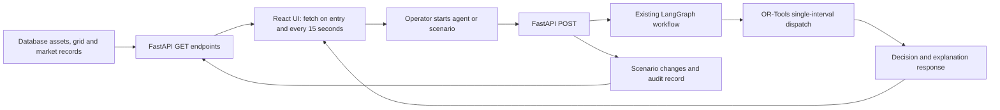

# Nexus Grid demo video: flow, UI and recording script

Use a 5–6 minute recording. The project addresses **Project 4 — Utilities: Renewable energy orchestrator**, from the Accenture hackathon requirements. This is a simulation prototype with real frontend-to-backend execution, not a connection to a physical utility grid.

## Verified data status

On October 9, 2026 (local time), a browser test changed grid demand through the existing backend scenario endpoint while leaving Command Center open. Demand changed from 3,453.7 MW to 4,317.1 MW and appeared automatically on the next periodic request, approximately 15 seconds later. No page refresh, navigation, UI scenario click, mocked response, or frontend-only animation was used. These large numbers belong to the isolated test database after repeated scenario tests; they are not real utility demand.

Evidence: `docs/evidence/live-data-verification.json` and `live-polling-test.txt`.

| Data                                                | Current source                                    | What can be claimed                                                      |
| --------------------------------------------------- | ------------------------------------------------- | ------------------------------------------------------------------------ |
| Demand, frequency, transmission capacity            | Latest database grid record                       | Current backend state; refreshes in the UI.                              |
| Electricity/carbon price, demand-response incentive | Database market records                           | Backend market data; scenario price changes persist.                     |
| Farm capacities, availability, battery SOC/rates    | Database asset records                            | API-connected portfolio telemetry from the simulated environment.        |
| Solar and wind output                               | Capacity multiplied by backend constants          | Estimated simulation output, not measured generation.                    |
| Weather, forecasts, analytics                       | Fixed existing backend responses                  | Demo values. Fetching them repeatedly does not make them live forecasts. |
| Decisions and optimization                          | Actual FastAPI, LangGraph and OR-Tools invocation | Real program execution and solver responses; model limitations remain.   |
| Scenario audit records                              | Persisted backend audit entries                   | Traceable scenario execution and recorded explanations.                  |

The UI refreshes every **15 seconds**. Scenario records advance by **15 simulated minutes**. These are different clocks. There is no background simulation clock or automatic orchestration loop. Values need not change on every refresh; fetching a new response does not generate a new measurement.

External weather/market feeds, SCADA/IoT telemetry and real operational assets are **not connected**. Connecting them would require additional backend integrations beyond the completed UI-only redesign. No random timer or fake frontend values were added to make the screen appear live.

## Explain the implemented end-to-end flow

1. **Observe data:** FastAPI reads assets and the newest grid and market records. The frontend displays the returned values. Solar/wind output is estimated by the current backend.
2. **Start execution:** Run Agentic Optimization sends a POST to `/api/orchestrator/run`. A scenario card sends a POST to `/api/scenarios/run?scenario_id=N`.
3. **Inject a scenario:** The backend inserts a new grid/market record with a 15-minute timestamp step. Some scenarios change demand, price or transmission capacity; others currently only record an event message.
4. **Execute the graph:** The implemented node order is analyze situation → check forecasts → check constraints → generate options → optimize → validate → simulate → evaluate/decide → explain.
5. **Solve the dispatch model:** OR-Tools computes solar/wind generation, charge/discharge, imports/exports and curtailment. The model has cost, carbon, curtailment, degradation and profit terms, plus a subset of the intended constraints.
6. **Return results:** The response contains the selected action, explanation and solver values. The frontend renders the response as received, without manufacturing reasoning or confidence.
7. **Persist scenario evidence:** Scenario runs create an audit entry containing the event, decision, explanation and optimization result. Standalone agent runs currently do not create an audit entry.
8. **Update the display:** Scenario controls trigger an immediate system-state fetch. Regular polling also detects backend changes while a page stays open. Read-only panels load their respective existing endpoints.

**Important fidelity limits:** the no-key fallback overwrites observed demand and price, and the optimizer uses several fixed model inputs. Consequently, changing dashboard demand or price does not prove that the selected dispatch adapts correctly. Forecast, constraint checking and simulation nodes contain placeholders; validation always reports PASSED. There are no execution, monitoring or automatic re-planning nodes. Explain these as remaining work, not completed autonomy.

## Ready-to-read narration and screen sequence

| Time      | Show / do                                                                                              | Narration                                                                                                                                                                                                                                                                                                                                                                                                  |
| --------- | ------------------------------------------------------------------------------------------------------ | ---------------------------------------------------------------------------------------------------------------------------------------------------------------------------------------------------------------------------------------------------------------------------------------------------------------------------------------------------------------------------------------------------------- |
| 0:00–0:25 | Open Command Center; keep the Simulation label visible                                                 | “This is Nexus Grid, our Agentic Renewable Energy Orchestrator for the Accenture hackathon’s utilities challenge. The goal is to coordinate renewable generation, battery storage, grid demand and market signals within one operational workspace. This demonstration uses a simulated environment.”                                                                                                      |
| 0:25–0:55 | Point to the four KPIs, energy diagram, API status and received time                                   | “The Command Center brings together solar generation, wind generation, demand and electricity price. The source diagram compares renewable output with demand, and the chart makes that balance easy to read. The interface fetches current backend state every fifteen seconds. Generation is currently estimated from asset capacity; this is not live utility telemetry.”                               |
| 0:55–1:20 | Live Grid, then Renewable Assets; expand one Details disclosure                                        | “Live Grid adds recorded grid frequency, transmission capacity, demand history and market context. Renewable Assets shows the database-backed portfolio of five solar farms and three wind farms, including capacity, location and availability. Asset details are accessible without leaving the page.”                                                                                                   |
| 1:20–1:40 | Battery Management                                                                                     | “Battery Management shows the two storage systems with state-of-charge gauges, rated energy capacity, charge and discharge limits, efficiency and degradation factors. The display uses the battery records returned by the API. Current dispatch power and battery history are not supplied by this version.”                                                                                             |
| 1:40–2:15 | Return to Command Center; click Run Agentic Optimization; wait for result                              | “Now I’ll invoke the agent pipeline. This button sends a real request to FastAPI. The existing LangGraph workflow runs its sequence of analysis, forecasting, option generation and optimization, then produces a decision and explanation. The numerical dispatch comes from OR-Tools rather than a frontend success animation.”                                                                          |
| 2:15–2:45 | AI Decisions; expand Optimization breakdown; then Optimization                                         | “AI Decisions presents the selected action and the exact explanation returned by the backend. Optimization exposes the solver’s generation, imports, exports, battery flows, curtailment and objective value. This is a single-interval recommendation model; its current fixed inputs and missing operational constraints are documented.”                                                                |
| 2:45–3:25 | Scenario Simulator; record current demand; click Demand Spike +25%; show response; return to dashboard | “The Scenario Simulator lets us inject an event through the existing backend. Here I’m selecting a twenty-five percent demand increase. The backend records the changed demand, invokes the agent graph, and returns a decision. Returning to the dashboard shows the updated demand from the API. This demonstrates the execution and data-update path; it does not establish full adaptive re-planning.” |
| 3:25–3:50 | Optional: Price Spike +100%, then dashboard price                                                      | “A market-price scenario follows the same path. The backend doubles the recorded electricity price, and the UI displays that persisted change. In the current fallback mode, the agent does not retain all observed inputs, so a changed market value may still produce the same dispatch result.”                                                                                                         |
| 3:50–4:15 | Decision History; expand newest record                                                                 | “Decision History makes the scenario traceable. Each entry shows the event, source timestamp, audit identifier, selected decision and explanation. These are persisted scenario audit records, which provide evidence that the request reached the backend.”                                                                                                                                               |
| 4:15–4:45 | Forecasting, then Analytics                                                                            | “Forecasting presents the available one-hour solar, wind and demand outlook, alongside recorded demand history. Analytics adds cost and carbon aggregates and current battery SOC. These endpoints currently use demo values; trained forecasting and measured financial or environmental impact remain future work.”                                                                                      |
| 4:45–5:10 | Alerts, then Settings; briefly resize to mobile                                                        | “Alerts and Settings clearly communicate the capabilities available in this build. A complete alert feed and editable configuration are not implemented. The interface remains consistent across all twelve views and adapts to smaller screens with accessible navigation, readable charts and clear connection feedback.”                                                                                |
| 5:10–5:35 | Close on Command Center or the energy chart                                                            | “Nexus Grid provides a unified renewable-energy command center with real API execution, an agent workflow, an optimization model and traceable scenario records. Our next steps are reliable observation-to-decision propagation, complete constraints, trained forecasts, external telemetry and risk-based human oversight.”                                                                             |

You may shorten the optional price scenario and last-page tour for a four-minute cut. If you want to demonstrate automatic polling visually, leave Command Center open while changing demand from a separate scenario session, then wait up to fifteen seconds. Do this only against the isolated simulation database.

## UI explanation for slides or video description

“Nexus Grid organizes the application into three areas. **Operations** covers the Command Center, Live Grid, Renewable Assets and Battery Management. **Intelligence** covers AI Decisions, Scenario Simulator, Forecasting and Optimization. **Workspace** contains Decision History, Analytics, Alerts and Settings. A consistent navy design, emerald renewable accents, cyan information states and amber/red warnings keeps the interface visually focused. Compact metric cards, responsive charts, source diagrams and expandable decision details allow viewers to move from system overview to supporting evidence. Simulation labels, API connection feedback, stale-data warnings and explicit unavailable states keep the presentation honest.”

## Recording preparation

- Use `http://localhost:4173` for the built frontend when the local preview and backend are running. This session uses an isolated synthetic test database.
- Test runs have compounded scenario changes. For realistic starting values, use a **new disposable demonstration database** initialized with the existing generator. Do not reset or reseed the operational database. There is no existing UI reset control.
- Show actual displayed numbers; do not read preset values from a script. Demand increase should be approximately previous demand ×1.25; price increase should be previous price ×2.
- Scenarios accumulate changes. Run the chosen demand and price scenarios once per recording, or explicitly describe repeated injections.
- Keep the browser at approximately 1440px for the main recording. Show mobile briefly, rather than squeezing every desktop panel into the video frame.
- Wait for API-connected status and completed loading states before narrating a number. Expand decision breakdowns and audit details to show evidence.
- If the explanation says “LLM Key Missing,” describe it as the existing template fallback. Do not claim live Gemini reasoning. The provider-dependent path has not been verified.
- Prefer the demand and price scenarios for the recorded state-change demonstration. Solar drop, wind spike, battery failure, storm and forecast-change events do not currently update their stated telemetry.
- Do not claim physical grid control, trained forecasts, real external feeds, persistent approvals, realized savings, full safety validation, or automatic re-planning. The optimization objective value is not a measured savings number.

A successful UI update is evidence of API connectivity; it is not, by itself, evidence of electrical feasibility or a completed original requirement.
